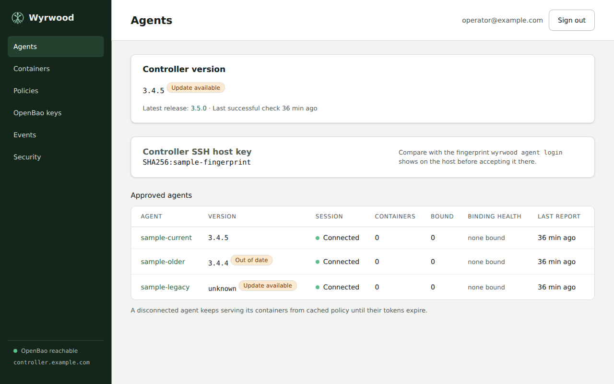

Policy lives on the controller. Agents receive the policies that match their
containers and cache resolved assignments. A controller outage can be tolerated
while the current tokens remain valid.

## Policy document

```yaml
name: teal-devcontainer
openbao:
  policy: |
    path "kv/data/teams/teal/*" { capabilities = ["read"] }
    path "auth/token/lookup-self" { capabilities = ["read"] }
    path "auth/token/renew-self" { capabilities = ["update"] }
    path "auth/token/revoke-self" { capabilities = ["update"] }
ssh:
  transit-keys:
    - teal-github
  ca-roles:
    - homelab
contract:
  mount-target: /run/wyrwood
  env:
    SSH_AUTH_SOCK: "{mount-target}/ssh-agent.sock"
    VAULT_ADDR: "unix://{mount-target}/vault.sock"
```

The controller validates the HCL through OpenBao before saving and writes it
as `wyrwood-teal-devcontainer`. Every Transit key and SSH role the policy
names must exist under the controller's configured mounts and must also be
permitted by the HCL.

## Access group

The binding's `settings.access-group` is effectively required for non-root
containers whose
processes run as a different UID from the host agent user. Set it to a numeric
host GID that the container processes have as a primary or supplementary group.
With an access group, the consumer directory is `0750` and sockets are `0660`.
Without one, they are `0700` and `0600`, owned by the agent user. A container
running as another non-root UID cannot use those owner-only sockets.

The agent user must belong to the host group so it can assign that group to
the directory and sockets. Add `wyrwood` to the consumer access group;
`docker` cannot serve as that group. For example, if the binding uses
GID 1000, find its host group name, add the agent user, and restart the agent
so it receives the new membership:

```bash
getent group 1000
sudo usermod -aG <host-group-name> wyrwood
sudo systemctl restart wyrwood-agent
```

Replace `<host-group-name>` with the name returned by `getent`. If the GID has
no host group, create one with that GID first. Repeat on each bound host.
The packaged service identity is `wyrwood`; the proxy accepts that UID and root.

Membership grants access: members of that host group who can reach the
consumer directory can use its sockets with the binding's OpenBao and SSH
permissions. Choose a group whose members you trust with those permissions.

## Token lifetime

`token-ttl` is how long a token lives between renewals; `token-max-ttl`, at
least as long, is how long it lives at most. The agent renews a token until it
nears its maximum lifetime, then logs in again with a fresh credential from
the controller. The maximum is therefore a trade-off: it bounds how long a
token the controller cannot revoke stays usable, and it is also how long a
controller outage can last before workloads lose secret access.

## Bindings

A binding attaches one or more policies to one container key on one agent.
Keys are tried in order: devcontainer identity labels, compose project and
service labels, container name. Token lifetime, access group, and enforcement
are binding settings, independent of the reusable policies:

```json
{
  "policies": ["teal-devcontainer", "shared-read"],
  "settings": {
    "token-ttl": "1h",
    "token-max-ttl": "8h",
    "access-group": 1000,
    "enforcement": "report"
  }
}
```

The web interface selects policies with checkboxes. **Preview effective
policy** shows source names and revisions, combined HCL, offered identities,
forwarding restrictions, contract, and settings before saving. Binding edits
submit the current revision; a stale edit must be reloaded.

HCL remains in separate OpenBao policies. OpenBao evaluates their union with
its normal path priority and deny rules; the displayed HCL includes each
source in stable name order. Transit keys and SSH roles are deduplicated
separately. A not-forwardable selector in any source restricts the selected
identity. Sources must require the same mount target. Environment entries
are merged after expanding `{mount-target}`; different values for one name
are rejected. A conflicting source edit is rejected before saving.

The controller creates one AppRole per binding carrying exactly the selected
`wyrwood-<policy-name>` policies. It disables the implicit `default` policy;
there is no managed lifecycle policy. Each author must include the three
self-operation paths shown above. The policy editor starts with those lines.
The editor, preview, and saved effective view warn when there is no explicit
`renew-self` update grant. This is advisory so deliberately non-renewing tokens
remain supported; OpenBao decides actual capabilities, including wildcards and
deny rules. A token without renewal permission can expire during a controller
outage.

Changing the selected policies, a source revision, or binding settings creates
a new assignment. The controller updates the AppRole and revokes the reported
old token before issuing fresh credentials. An offline agent's containers lose
access until the agent reconnects. A failed transition remains pending and
blocks fresh issuance; startup and subsequent credential requests attempt the
pending transition. An unreported token remains bounded by its maximum TTL.
Late old-assignment accessor reports are revoked rather than saved as current.

Deleting a binding deletes its AppRole and revokes the reported token even
while the agent is offline. If revocation fails, the response says that the
token can remain valid until the agent revokes it or it expires.

## Contract enforcement

`report` is the default. The agent checks the mount, the environment names and
values, and the access group on every reconcile and reports what is missing.

`recreate` makes the agent apply the contract once, when the binding is first
bound to a container. The agent stops, removes, and creates the container from
its inspected definition with the mount and environment merged in. Later drift
is reported, not recreated. The host's agent configuration must also allow
recreate; otherwise the binding is reported as non-conforming with that
reason.

## Agent configuration

`/etc/wyrwood/agent.yml` holds only what is needed to reach the controller
and the engine:

```yaml
controller:
  url: ssh://controller.example.internal:2222
engine:
  socket: /var/run/docker.sock
  proxy-socket: /run/wyrwood-engine/engine.sock
  allow-recreate: false
```

`engine.socket` is the proxy's upstream; the agent uses `engine.proxy-socket`.
The proxy reads the root-controlled file itself. Set `allow-recreate: true`
only when arbitrary create/start authority on this host is acceptable: a
compromised agent can still take over a recreate-enabled host. Activate any
change with `sudo systemctl restart wyrwood-agent.service`, which restarts
the proxy too. Both configuration paths and custom proxy socket directories
must meet the protected ownership rules described in [Installation](install.md).

The agent key, accepted controller fingerprint, cached policy, events, and
the journal of each recreate in progress live under `/var/lib/wyrwood`. No
token or secret is ever written there.

## Controller configuration

`/etc/wyrwood/controller.yml` names the listen addresses, the state
directory, the OpenBao connection, and the OpenID Connect provider operators
sign in through. The AppRole secret identifier and the client secret are read
from files:

```yaml
http:
  listen: 127.0.0.1:8080
  session-ttl: 12h
ssh:
  listen: 0.0.0.0:2222
openbao:
  address: https://openbao.example.internal:8200
  namespace: wyrwood
  approle:
    role-id: REPLACE_WITH_ROLE_ID
    secret-id-file: /run/secrets/openbao-secret-id
  transit-mount: transit
  ssh-mount: ssh
  secret-mounts:
    - path: kv
      type: kv-v2
    - path: certificates
      type: other
oidc:
  provider-name: Pocket ID
  issuer: https://id.example.internal
  client-id: REPLACE_WITH_CLIENT_ID
  client-secret-file: /run/secrets/oidc-client-secret
  redirect-url: https://wyrwood.example.internal/auth/callback
  groups-claim: groups
  allowed-groups:
    - wyrwood-operators
```

`openbao.secret-mounts` is an optional catalog of expected secret engines,
empty by default. Each entry has a unique `path` inside the namespace, without
slashes, and a `type` of `kv-v2` or `other`. Paths use letters, digits, dot,
dash, and underscore; dot-only and double-dot paths are invalid. OpenBao's
reserved roots `sys`, `auth`, `identity`, `cubbyhole`, and `audit` cannot be
secret mounts. The catalog
supports policy warnings and editor path pickers. It creates no mounts and
changes no OpenBao permissions.

Register the controller with the provider as a confidential client using the
authorization-code flow with PKCE, with the redirect URL above. The URL is the
public address behind your reverse proxy, not the loopback listen address.
The provider must include group membership in the ID token, which Wyrwood
requests with the `groups` scope. An account is admitted only when one of its
groups is listed under `allowed-groups`; the web interface cannot change the
list.

## Release checks

The **Agents** page shows the controller build version and each approved
agent's version. An agent older than the controller is marked **Out of date**.
An agent that omits its version can still connect and shows **unknown** with
**Update available**. Development builds remain visible; they are not compared
as release versions.



Release checks are disabled by default. To enable outbound HTTPS requests from
the controller to GitHub, add this to `controller.yml` and restart the controller:

```yaml
update-checks:
  enabled: true
  interval: 24h
  timeout: 10s
```

`interval` and `timeout` are configurable positive Go durations, such as `6h`
and `20s`. There is no additional interval floor or timeout ceiling beyond a
positive duration that Go can represent. Choose an interval appropriate for
external release checks; very short intervals increase requests to GitHub.
The defaults are 24 hours and 10 seconds. An enabled controller checks
at startup, then waits the configured interval after each attempt. The timeout
bounds each complete check. Checks run in the background, without blocking
startup, agent sessions, or pages. Failed checks wait for the same interval;
there is no immediate retry.

The controller reads the public `wyrd-company/wyrwood/releases/latest` redirect
using an HTTP client, without the GitHub API or a credential. It compares the
release tag with its build version using SemVer, including prereleases and build
metadata. The page shows **Update available** with the release link when a newer
release exists. **Up to date** requires a successful check and a comparable build
version.

For an offline or air-gapped controller, leave `enabled` false or omit
`update-checks`. No release request is made. If an enabled check fails, the page
shows **Update check unavailable**, writes a fixed failure category to the
controller journal, and retains the last successful result with
its age. Observations are held in memory and start empty after a restart.

## Policy path warnings

The policy editor checks HCL path stanzas against the configured AppRole,
Transit, SSH, and secret-engine mounts, plus the exact `auth/token/lookup-self`,
`auth/token/renew-self`, and `auth/token/revoke-self` paths. A path such as `kv/*`
or `kv/data/+/entry` stays inside a configured `kv` mount; `kv*`, `+/data/*`,
`auth/+/role/*`, and `sys/*` can reach outside the configured mounts and produce
an advisory warning. The check reads path stanzas, including deny stanzas; it
does not evaluate effective OpenBao capabilities or path priority.

Checks run when the editor opens and when you leave the HCL field. A warning,
unreadable HCL, or an unavailable warning check never blocks saving. OpenBao
validates the HCL on save. An outside grant can be intentional; list a secret
engine in `openbao.secret-mounts` when it is part of the expected scope.

## OpenBao namespace

The controller runs in a dedicated OpenBao namespace. OpenBao does not limit
the HCL a token writes to the capabilities that token holds, so the
controller, and any operator, can grant every access in the namespace the
controller runs in. A dedicated namespace keeps that access inside Wyrwood.

The namespace holds:

- the AppRole auth mount the controller and binding AppRoles use
- the controller's own policy and AppRole
- the Transit and SSH-engine mounts the controller manages
- every secret engine containers read, for example KV

Paths in policies are relative to the namespace, so a policy names
`kv/data/...`, not `wyrwood/kv/data/...`. Set `openbao.namespace` to the
namespace path; the controller, the agents, and the container vault sockets
all send it.

Name the controller's own policy and AppRole outside the `wyrwood-` prefix,
for example `controller`. The controller writes only `wyrwood-` names, so it
cannot rewrite its own policy or AppRole. Every binding AppRole carries only
its selected `wyrwood-` policies and no implicit `default` policy.

The controller's policy, for the default `approle`, `transit`, and `ssh`
mounts:

```hcl
path "sys/policies/acl/wyrwood-*" {
  capabilities = ["create", "read", "update", "delete", "list"]
}
path "auth/approle/role/wyrwood-*" {
  capabilities = ["create", "read", "update", "delete", "list"]
}
path "auth/approle/role/wyrwood-*/role-id" { capabilities = ["read"] }
path "auth/approle/role/wyrwood-*/secret-id" {
  capabilities = ["create", "update"]
}
path "sys/wrapping/wrap" { capabilities = ["update"] }
path "transit/keys" { capabilities = ["list"] }
path "transit/keys/*" { capabilities = ["create", "read", "update", "list"] }
path "ssh/roles" { capabilities = ["list"] }
path "ssh/roles/*" { capabilities = ["create", "read", "update", "list"] }
path "auth/token/renew-self" { capabilities = ["update"] }
path "auth/token/revoke-accessor" { capabilities = ["update"] }
```

Change the mount names in the paths when you configure other mounts. The
controller revokes only the token accessors its agents report.
