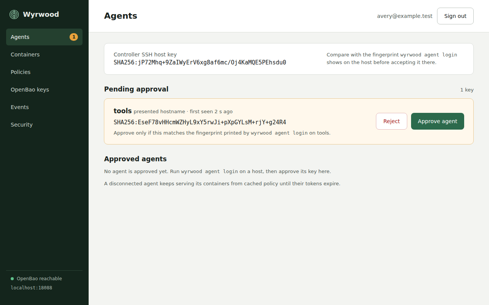
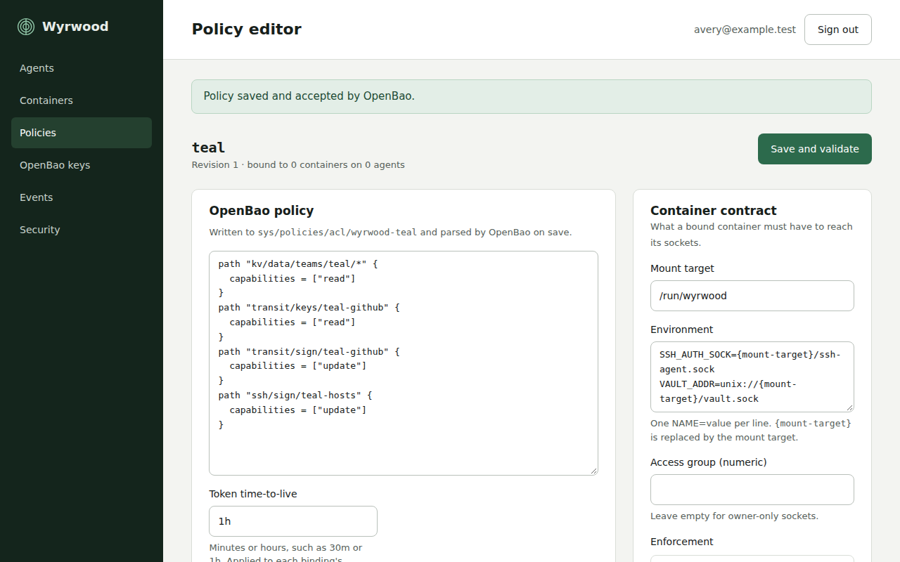
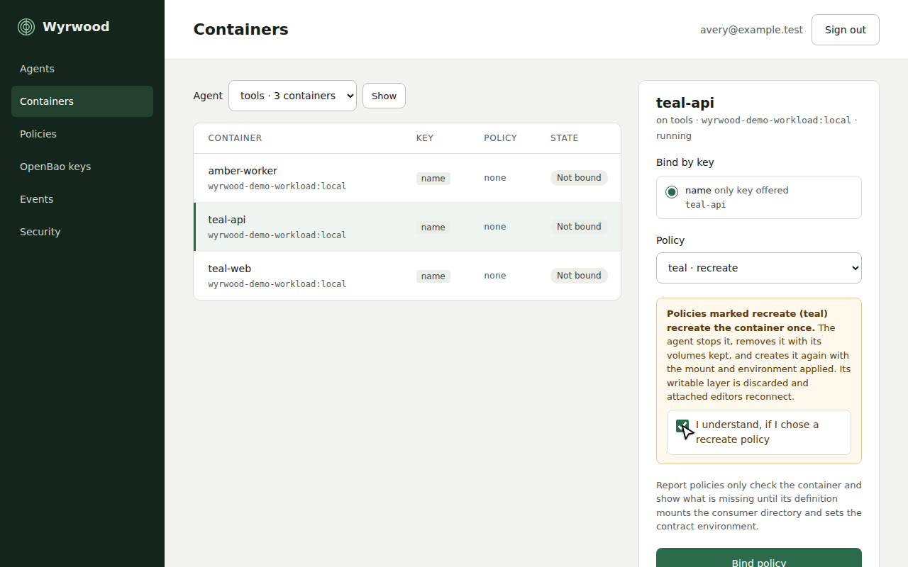
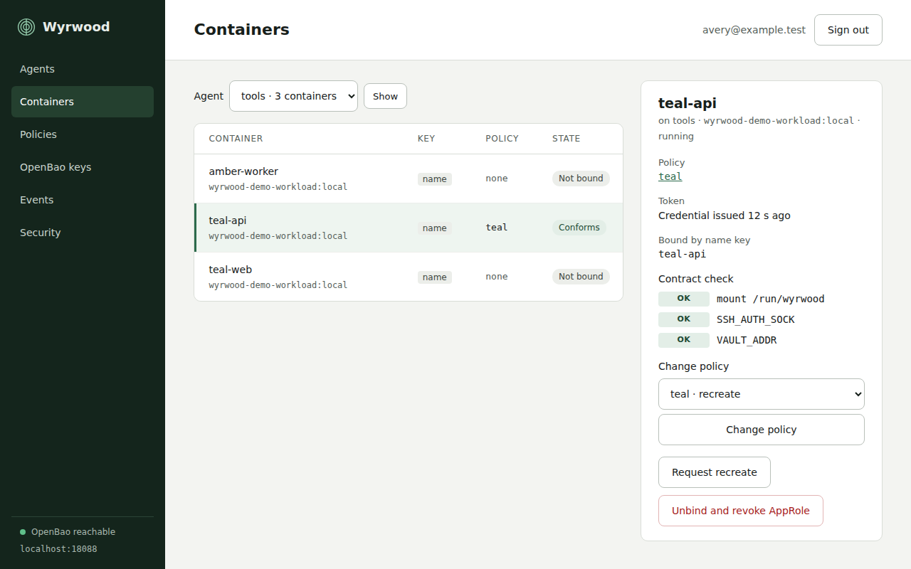

This walk-through enrolls one host, writes one policy, and binds one
container.

## Enroll the agent

On the host, point the agent at the controller. The command generates the
agent's key pair, prints its fingerprint, and shows the controller's host-key
fingerprint for you to accept.

```bash
sudo wyrwood agent login ssh://controller.example.internal:2222
sudo wyrwood agent service start
```

Sign in to the controller's web interface through your identity provider,
open **Agents**, and approve the pending key after comparing its fingerprint
with the one the login command printed. The host's containers appear once
the agent reports in.



## Write a policy

Open **Policies** and create one. A policy has three parts:

1. The OpenBao policy, in HCL. For example, read access to one KV path and
   signing with one Transit key:

   ```hcl
   path "kv/data/teams/teal/*" {
     capabilities = ["read"]
   }
   path "transit/sign/teal-github" {
     capabilities = ["update"]
   }
   path "transit/keys/teal-github" {
     capabilities = ["read"]
   }
   ```

2. The SSH identities the agent socket should offer. Name the Transit key
   `teal-github`. Name an SSH-engine role if a host you reach trusts the
   OpenBao CA.

3. The contract. The default mounts the consumer directory at `/run/wyrwood`
   and sets `SSH_AUTH_SOCK` and `VAULT_ADDR` to the sockets inside it. Set
   the access group to the numeric group your container's processes use.
   Leave enforcement at `report` unless you want the agent to recreate the
   container with the mount applied when you bind it.

An access group is effectively required for non-root containers running as
another UID than the agent. Without it, the agent owns the directory (`0700`)
and sockets (`0600`); with it, their modes are `0750` and `0660`.

On each host, add the agent user to the chosen group and restart the agent.
For access group 1000:

```bash
getent group 1000
sudo usermod -aG <host-group-name> wyrwood
sudo systemctl restart wyrwood-agent
```

Replace `<host-group-name>` with the host group name for GID 1000. Create a
host group with that GID first if none exists. Use a separate group from
`docker`; the agent has no direct Docker access. Members of the access group
who can reach these sockets can use the
binding's OpenBao and SSH permissions. See [Access group](configuration.md#access-group).



## Bind a container

Open **Containers**, select the container, and choose the policy. The
controller binds by the most stable key the container offers and shows which
one it used. The agent creates the container's consumer directory, obtains
its OpenBao token, and checks the contract.



A container created without the mount is reported as non-conforming. Either
add the mount and environment to the container's definition and recreate it
yourself, or set the policy's enforcement to `recreate` and bind again. A
recreate stops, removes, and creates the container once. Anything outside a
mount or volume is discarded, and an attached editor session reconnects.

For a manual recreate, use this order:

1. Bind the existing container and wait for the agent to create
   `/run/wyrwood/containers/<container-name>` on the host. Use the container's
   Docker name for this path, including when the binding uses a label key.
2. Add the mount and environment variables to the replacement definition.
   Use `--mount type=bind` so Docker fails if the source directory is absent.
3. Remove the old container and create the replacement with the same Docker
   name and binding key. Keep the Docker name even when the binding uses a
   label key: the consumer directory is named after the container. The agent
   keeps that directory through the gap and restores its sockets when the
   replacement receives its binding.

For example, replace a container named `app`:

```bash
docker rm -f app
docker run -d --name app \
  --mount type=bind,src=/run/wyrwood/containers/app,dst=/run/wyrwood \
  -e SSH_AUTH_SOCK=/run/wyrwood/ssh-agent.sock \
  -e VAULT_ADDR=unix:///run/wyrwood/vault.sock \
  alpine sleep infinity
```

Keep the image, other mounts, labels, and options your application needs.
Avoid `-v` for this mount: Docker creates a missing source as root, and the
agent rejects directories owned by another user.

If Docker has already created a root-owned source, stop the container before
repairing it. Check that the directory is empty, then replace it with one owned
by the agent service user. For the default service configuration without an
access group:

```bash
docker stop app
sudo rmdir /run/wyrwood/containers/app
sudo install -d -o wyrwood -g wyrwood -m 0700 /run/wyrwood/containers/app
docker start app
```

Stop if `rmdir` fails; do not recursively delete the directory. The agent applies
its configured access group when it opens the repaired directory. Repair before
starting the container so its bind mount refers to the new directory.



For a devcontainer named `app`, set the Docker name explicitly so rebuilds
reuse its consumer directory. Use the existing container's Docker name in both
`runArgs` and the mount source, and choose a name unique on that Docker host:

```json
{
  "runArgs": ["--name", "app"],
  "mounts": [
    "source=/run/wyrwood/containers/app,target=/run/wyrwood,type=bind"
  ],
  "containerEnv": {
    "SSH_AUTH_SOCK": "/run/wyrwood/ssh-agent.sock",
    "VAULT_ADDR": "unix:///run/wyrwood/vault.sock"
  }
}
```

## Use the sockets

Inside the container:

```bash
bao kv get kv/teams/teal/example
ssh-add -L
git -c core.sshCommand=ssh push
```

The first command carries the container's token without the container ever
seeing it. The second lists the Transit key. The third signs the push in
OpenBao.
