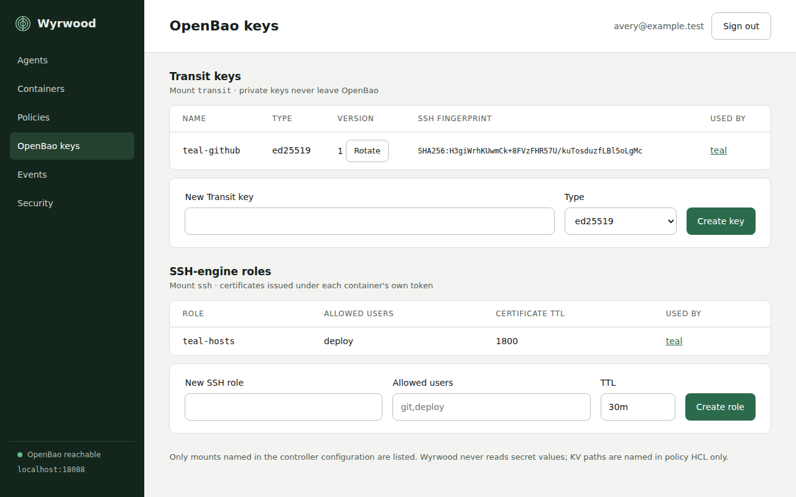
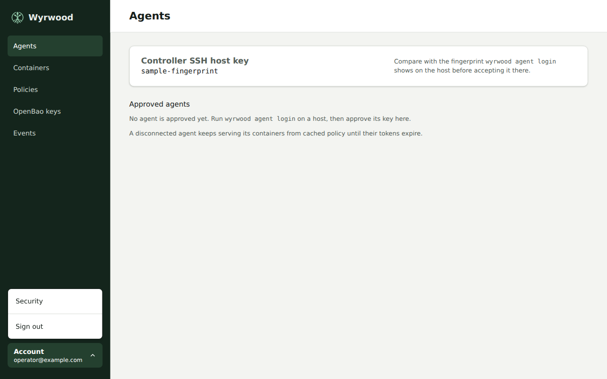
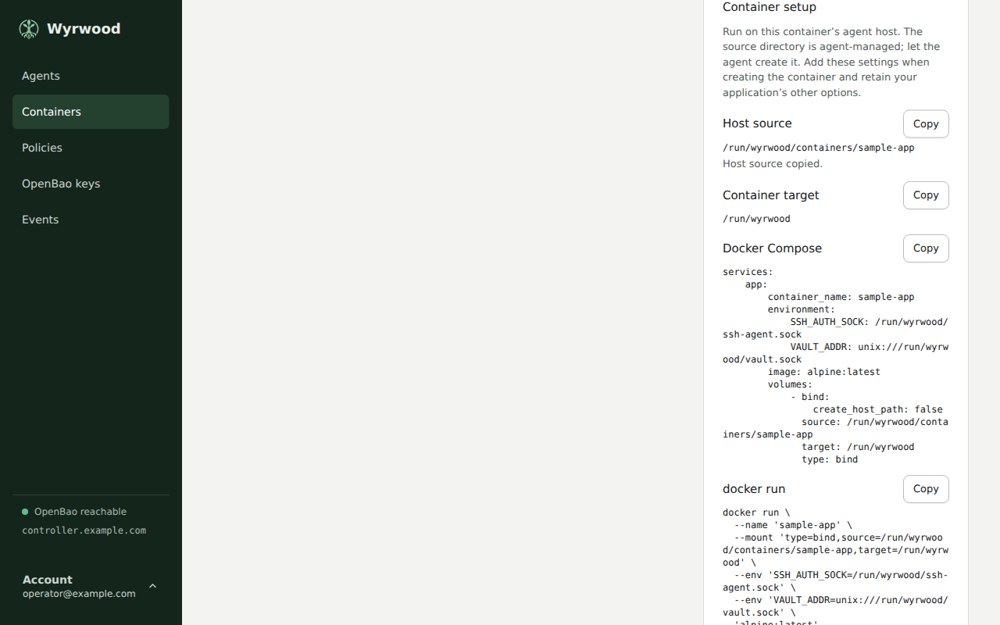
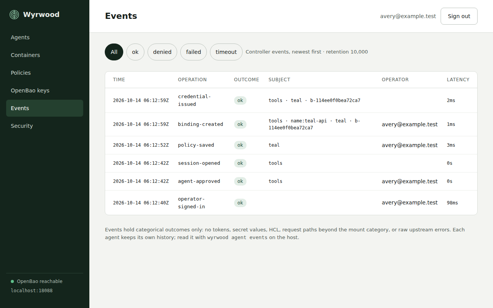

Wyrwood provides human-readable output for interactive use and closed,
versioned JSON for automation.

```bash
sudo wyrwood agent status
sudo wyrwood agent containers
sudo wyrwood agent events --limit 50
sudo wyrwood agent status --output json
```

Successful output goes to standard output. Categorical errors go to standard
error. Automation can distinguish usage, login, daemon, controller, and
fingerprint failures by exit status without parsing error text.

## Web interface

The controller's web interface shows agents with pending approvals,
all reported containers with binding and conformance state, policies, OpenBao
keys under the managed mounts, and events. Bind it to loopback and place it
behind a reverse proxy that terminates TLS.



Open **Account** at the bottom of the sidebar to select **Security** or
**Sign out**. The account button shows the signed-in operator. Use the arrow
keys to move between menu items and Escape to close the menu.



Operators sign in through the site's OpenID Connect provider. The controller
admits an account only when its groups claim names a group listed under
`oidc.allowed-groups`, and checks membership at every sign-in. Remove someone
from the group in the provider to revoke their access at their next sign-in;
their open session ends at the session time-to-live or when an operator ends
it from **Security**. While the provider is unreachable the interface cannot
be used, but agents keep serving containers.

## Container setup

**Containers** shows all approved agents’ last reported containers. Filter by
agent or text, sort by container, agent, image or binding state, and choose
ascending or descending order. Disconnected rows retain the last report and
show its age. Selecting a container keeps the current filters and order.

In **Containers**, select a bound container and open **Container setup**. Copy
the host source, container target, Docker Compose fragment, or `docker run`
example. The examples use the saved effective contract, including its
environment values and custom mount target. Run them on the selected agent
host when creating the container, and keep your application's other options.

The host source comes from the agent's configured consumers root and the
actual container name. The agent manages this directory. Let the agent create
it before starting the container; the Compose fragment disables automatic
host-path creation. The examples do not include application commands, ports,
networks, or unrelated mounts. They do not change an existing container.



If the report lacks the consumer directory or image, setup examples are
unavailable. An agent that omits the directory must be updated. Follow the
[controller-first upgrade order](install.md#upgrade-order) before updating
agents. If clipboard access is unavailable, select and copy the displayed
text.

## Operational events

The agent and the controller each retain a bounded event history. Agent
events cover container observation, bindings, contract checks and recreates,
token login and renewal, vault requests by mount category, and SSH identity
listing, signing, and certificate issuance. Controller events cover operator
sign-in and sign-out, agent approval, sessions, policy saves, bindings, and
credential issuance, and name the operator who acted. Events contain no
tokens, secret values, request bodies, paths, signatures, or raw upstream
errors.



## Commands

| Command | Purpose |
| --- | --- |
| `wyrwood controller serve` | Run the controller. |
| `wyrwood controller host-key` | Print the controller's SSH host-key fingerprint. |
| `wyrwood agent login <url>` | Generate the agent key, accept the controller fingerprint, and request approval. |
| `wyrwood agent daemon` | Run the agent through its Engine proxy. |
| `wyrwood agent engine-proxy [--config PATH]` | Run the filtering Engine boundary. |
| `wyrwood agent status` | Inspect agent, controller session, and binding health. |
| `wyrwood agent containers` | List observed containers with binding, conformance, and token state. |
| `wyrwood agent events` | Read the newest bounded operational events. |
| `wyrwood agent service install\|remove\|start\|stop\|status` | Manage the system service pair. |
| `wyrwood version` | Print the executable version. |

Run `wyrwood help` for the top-level grammar or append `--help` to a command
for its options.

## Agent and Engine proxy

`wyrwood-agent.service` runs as `wyrwood`. Its dependency
`wyrwood-engine-proxy.service` runs as `wyrwood-engine` with Docker access.
Restart the agent to activate both its configuration and the proxy's
root-controlled `allow-recreate` setting:

```bash
sudo systemctl restart wyrwood-agent.service
sudo systemctl status wyrwood-agent.service wyrwood-engine-proxy.service
```

The proxy permits four reads: container list, container inspect, filtered
container events, and image inspect. Stop, remove without volumes or force,
create, and start are allowed only with host recreate enabled. All other
Engine routes are denied. A recreate-enabled host still grants possible
host-root authority to a compromised agent.

A proxy failure leaves Engine operations unavailable while existing consumer
sockets continue serving. Reconnect uses the filtered socket and full reconciliation;
it does not switch to the raw Engine socket. A restart during recreation
follows the [existing recovery procedure](configuration.md#contract-enforcement).

## OpenBao namespace secret access

Members of `wyrwood_admins` can sign in to OpenBao directly to manage ad-hoc
secrets. This is a separate OIDC client and application session from the
controller's sign-in. The controller's allowed groups and AppRole policy stay
unchanged. An OpenBao administrator performs setup; the controller service
never configures auth methods.

Set the public cluster UI base and namespace in the controller configuration:

```yaml
openbao:
  address: https://api.example:8200
  namespace: wyrwood
  ui-url: https://vault.example/ui/openbao
  # Keep the existing approle, CA and managed-mount settings.
```

`ui-url` includes the deployed `/ui/<cluster>` route and any proxy prefix. It
can use a different hostname from the API address. HTTPS is required except
for loopback tests. With this example, register exactly
`https://vault.example/ui/openbao/auth/admin-oidc/oidc/callback` on the separate
OpenBao OIDC client. The namespace travels in OIDC state, not the callback
query. Request the `profile`, `email`, and `groups` scopes and release a groups
claim that includes the exact string `wyrwood_admins` for admitted accounts.

Have an OpenBao site administrator supply a provisioning token issued in the
target namespace. Its [exact provisioning ACL](technical-designs/openbao-admin-access.yml)
can write the `namespace-admin` policy and configure `auth/admin-oidc`. Treat
that policy writer as namespace administration authority. Keep its input file
under the administrator's control; do not give it to the controller or secret
admins. Revoke it through the site's process after use. Root on the local
machine is not required.

Pipe the OIDC client secret from your secret source into the command. For
example, with an administrator-managed input file:

```bash
wyrwood controller openbao-admin configure \
  --config /etc/wyrwood/controller.yml \
  --token-file /run/secrets/provisioning-token \
  --client-id openbao-admin-client --client-secret-stdin \
  --kv-v2-mount kv --token-ttl 1h --token-max-ttl 8h \
  < /run/secrets/openbao-client-secret
```

Choose the TTL and maximum explicitly. These example values are not defaults.
The issuer and claim key default to the controller's public OIDC settings;
`--issuer URL` and `--groups-claim KEY` override them. The client secret is
consumed from piped stdin without an interactive prompt. Wyrwood never saves
or logs it, and never reads the controller's runtime secret files for this
command. OpenBao stores its required copy in protected backend storage. Keep
OpenBao audit HMAC protection for the field and verbose OIDC logging disabled.

Repeat `--kv-v2-mount` to grant another existing KV v2 mount. The role grants
read, create, update, list, delete, restore, and permanent version/metadata
deletion on all values in those mounts, including existing workload secrets.
It also grants own-token lookup, renewal, revocation, and UI capability
inspection. It grants no policy, AppRole, auth-method, engine-mount, Transit,
SSH, identity, or child-token administration. Keep its OpenBao identity aliases
free of extra entity or group policies. A person who also operates Wyrwood
retains that separate controller authority.

The sidebar and policy editor show **OpenBao UI**, opening the selected
namespace's secret-engine list in a new tab. OpenBao handles sign-in; an
existing OpenBao session retains its own authority. The editor's unsaved form
stays in place. An absent or empty `ui-url` hides both links. Opening a link
or signing out of Wyrwood does not grant or revoke OpenBao access.

Setup recognizes its dedicated resources and refuses conflicting policies,
auth mounts or extra roles. An error reports its stage and whether partial
configuration can remain. Rerun setup with the complete explicit inputs to
finish or rotate the client secret, or remove the owned resources:

```bash
wyrwood controller openbao-admin remove \
  --config /etc/wyrwood/controller.yml \
  --token-file /run/secrets/provisioning-token
```

Removal disables the dedicated auth mount first, revoking its issued tokens
and leases, then deletes its ACL policy. It preserves KV values and mounts,
the namespace, controller policy/AppRole and binding policies/AppRoles.
Remove or rotate the separate provider client, revoke the provisioning token,
and remove `ui-url` from configuration to hide the links. Group removal only
stops subsequent logins; issued tokens need revocation or expiry at their
explicit maximum lifetime. Deleting only the role does not revoke sessions.
