Use the controller's web interface for daily operations. Use the agent CLI
on a host for diagnostics and automation. Installation and service changes
use host commands; policies and bindings are managed in the web interface.

## Web interface

The controller's web interface shows agents with pending approvals,
bindings with their conformance state, reported containers, policies, OpenBao
keys under the managed mounts, and events. Bind it to loopback and place it
behind a reverse proxy that terminates TLS.

| In the web interface | Action |
| --- | --- |
| **Agents** | Compare fingerprints, approve pending agents, and check connections and versions. |
| **Policies** | Create or edit HCL, select SSH identities, save and validate, see the bindings that select a policy, rename a policy, and delete a policy that no binding selects. |
| **Bindings** | Find a binding, inspect its state and contract check, or use **Add binding** to bind a reported container. |
| **OpenBao keys** | Inspect the available Transit keys and SSH-engine roles. |
| **Operator keys** | Approve a key for scripts with its grant, reject one, and revoke one. |
| **Settings** | Inspect effective controller configuration loaded at startup. |
| **Events** | Read the controller's operational history. |
| **Account → Security** | Inspect sign-in details and end operator sessions. |
| **Report an issue** | Open the GitHub form for a new Wyrwood issue in a new tab. The link sends no data about your site. |

On a phone, or in a window narrower than 792 pixels, the navigation is a bar
at the top of each page. Select **Menu** to show the destinations, their
pending counts, the OpenBao status, **Report an issue**, and **Account**.
Select **Menu** again, or press Escape, to hide them. Each page opens with the
menu closed, so the page starts in the first screen.

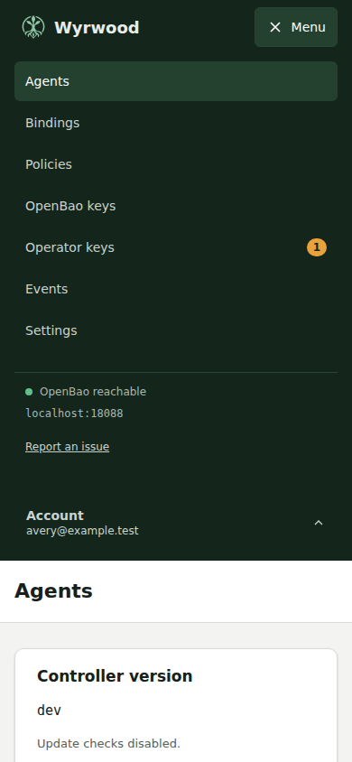

Follow [Getting started](getting-started.md) for agent approval, policy
creation, and container binding with screenshots.

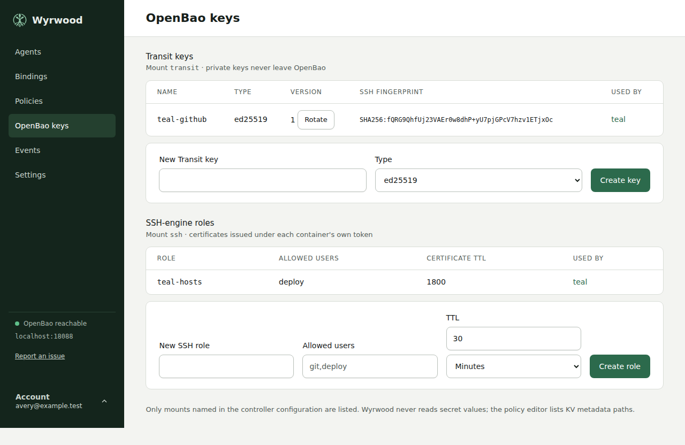

When a list on **OpenBao keys** is incomplete, the page says why above the
lists:

| Message | Meaning |
| --- | --- |
| **OpenBao did not answer.** | The controller could not reach OpenBao, or the request timed out. Agents keep serving containers. |
| **Transit keys could not be listed: permission refused.** | OpenBao refused the controller's list of the Transit mount. Check the `list` capability on `<transit mount>/keys` in the controller policy. SSH roles have the same message. |
| **Transit key `name` could not be read: permission refused.** | OpenBao listed the key but refused to read it. The other keys stay listed. Check the `read` capability on `<transit mount>/keys/name`. |

Another category, such as **OpenBao did not answer**, **not found**, or
**OpenBao answered with an error**, can take the place of **permission
refused**. When a key read gets no answer, the keys read before it stay listed
and no further key is read. Imported Transit keys are listed
like generated keys. The policy editor's **SSH identities** tab shows the same
Transit messages, and keeps saved selections.

Open **Account** at the bottom of the sidebar, or of **Menu** on a phone, to
select **Security** or **Sign out**. The account button shows the signed-in
operator. Use the arrow keys to move between menu items and Escape to close
the menu.

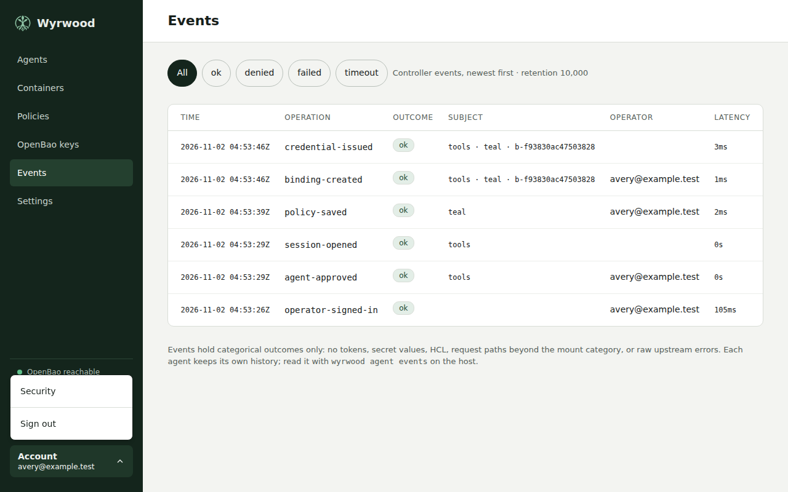

Operators sign in through the site's OpenID Connect provider. The controller
admits an account only when its groups claim names a group listed under
`oidc.allowed-groups`, and checks membership at every sign-in. Remove someone
from the group in the provider to revoke their access at their next sign-in;
their open session ends at the session time-to-live or when an operator ends
it from **Security**. While the provider is unreachable the interface cannot
be used, but agents keep serving containers.

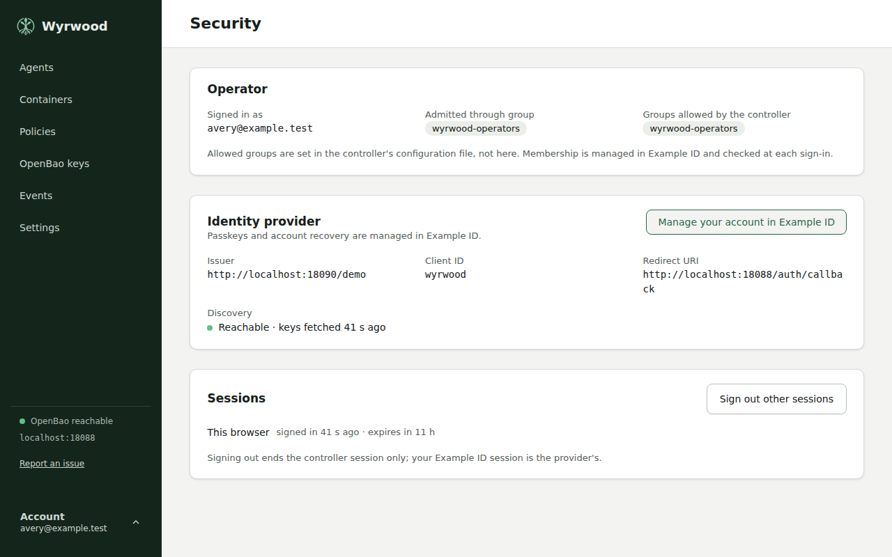

## Rename a policy

Open a policy and select **Rename**. Enter the new name, which follows the same
rule as any policy name and must not be in use. You can rename a policy that
bindings select. The screen states how many bindings are affected and lists
them. Each one gets a fresh credential, and its token lifetime does not change.

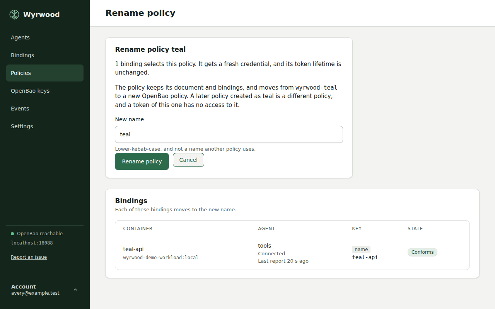

The policy keeps its document, HCL, and bindings. Its OpenBao policy changes to
the one for the new name, and the old OpenBao policy is removed after every
binding has moved. A container's old token is revoked and it reads with the new
token, as with any binding change. An agent that is not connected takes the new
assignment and a fresh credential when it reconnects.

If you rename `alpha` to `beta`, and later create a policy named `alpha`, the
new `alpha` is a different policy with its own OpenBao policy, such as
`wyrwood-alpha--2`. A token of the renamed policy has no access to it. The same
is true when you rename a policy back to a name it had before.

If OpenBao is not available after the rename is recorded, the policy page says
the transition is pending. The old OpenBao policy stays until the controller
finishes. The controller retries while the work is pending, with no action from
you and without a restart. If OpenBao refuses the new policy before the rename
is recorded, the policy keeps its name.

If you submit the current name, nothing changes. The policy page opens and says
that the name did not change.

A page opened before a save or an earlier rename cannot rename the policy:
reload it and try again.

## Delete a policy

Open a policy and select **Delete policy**. The confirm screen names the policy
and its OpenBao policy, `wyrwood-<name>` on the first use of a name. Delete
removes both.

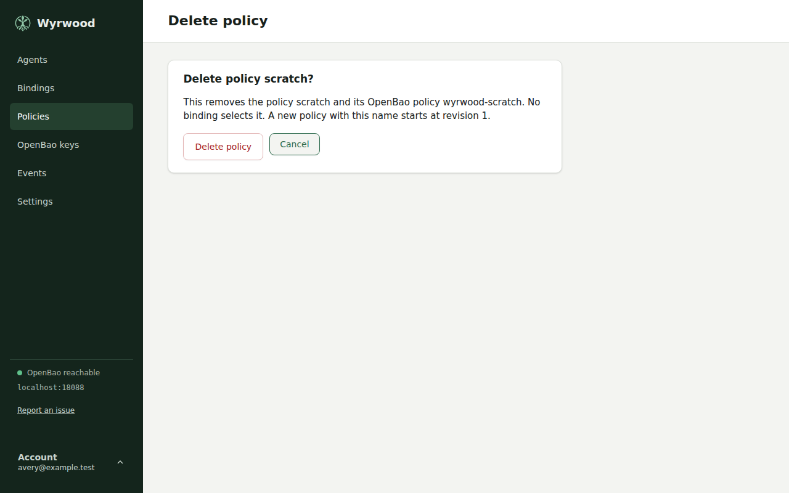

You cannot delete a policy while a binding selects it. The screen lists each
binding that blocks the delete, with a link to it. This includes a binding
marked `Not reported`, whose container no longer exists, and a binding on an
agent that is not approved. Change or unbind each one, then delete the policy.
There is no forced delete, and a delete never unbinds a container.

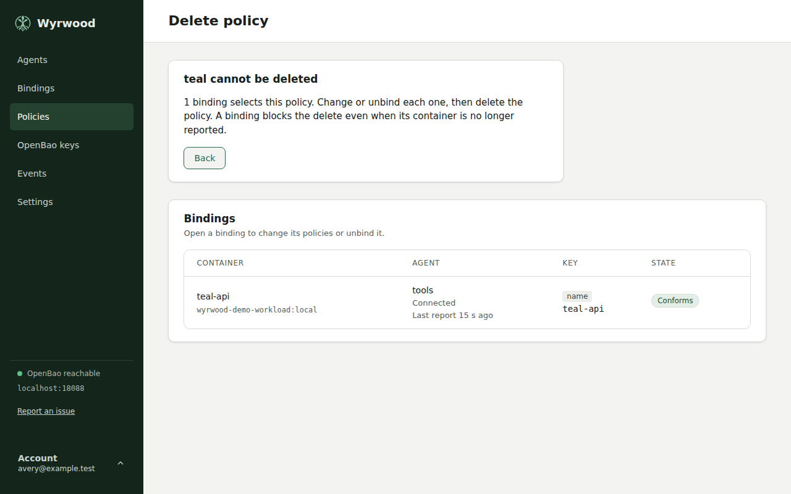

If OpenBao or the controller's database fails during a delete, the page shows
the error and the policy stays, so you can try again.

You can create a new policy with the name of a deleted policy. It starts at
revision 1 and is a different policy: its OpenBao policy is
`wyrwood-<name>--<number>`, so a token that outlived the earlier policy has no
access to it. The page of a policy shows its OpenBao policy.

## Controller settings

Open **Settings** in the sidebar to inspect the controller version, listen
addresses, session lifetime, state directory, OpenBao namespace and mounts,
operator sign-in configuration, and update checks. **Local agent** shows the
effective enabled or disabled value of `local-agent.enabled`. See
[Controller with a local agent](install.md#controller-with-a-local-agent) for
enrollment and host service operation.

The page is read-only. Edit the [controller configuration](configuration.md)
and restart the controller to change these values. Credentials and
credential-file paths are omitted. Endpoint origins show only scheme and host.

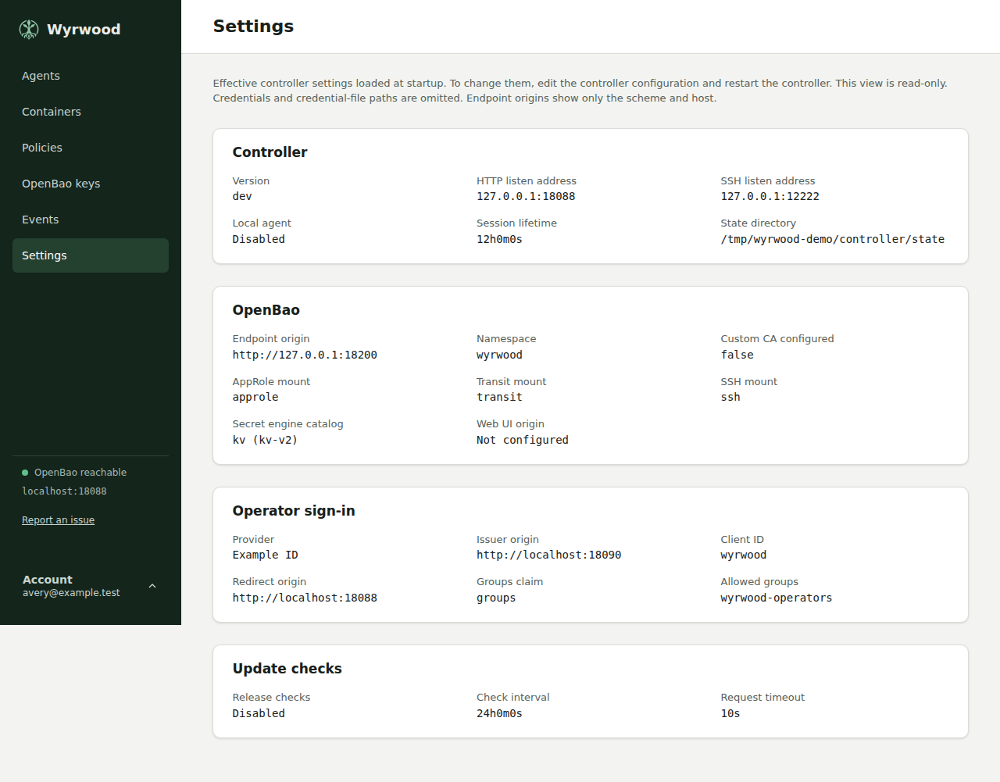

## Container setup

**Bindings** lists every binding of the approved agents, with the containers
each one governs. Filter by agent or text, sort by container, agent, image, key,
policies or state, and choose ascending or descending order. Disconnected rows
retain the last report and show its age. A binding whose container the agent no
longer reports stays in the list, marked **Not reported**, with its agent and
key. This is not an error, and the binding applies again when a container with
its key returns. **Edit** on a row, or a container's name, opens the binding's
screen. **Back to bindings**
returns to the list with the same filters and order.

A `name` binding keeps its consumer directory and sockets while it has no
container, also across an agent restart, so a replacement with that name can
mount the directory on its first start. The agent revokes the token when the
container goes. It gets a new token from the controller when a container with
that name appears, usually within seconds of `docker create`. Until then,
requests fail: `vault.sock` answers with status 503 and the error `no-token`.
A binding on another key keeps its directory but not its sockets, unless it has
a directory name: see
[Bind a container before it exists](#bind-a-container-before-it-exists).

**Add binding** lists the reported containers that have no binding, with the
same filters. Every container an agent reports is on one of these two pages.
**Add binding** on a row, or a container's name, opens its bind screen. Links to
the former `/containers` address go to **Bindings** and keep their agent filter,
text filter, and sort. A container selected by a former link is not kept.

### Bind a container before it exists

Select **Bind by typed key** on **Add binding** to bind a container that no
agent reports yet. On the **Key and policies** tab:

1. Choose the **Agent**. Only approved agents are listed.
2. Choose the **Key kind** and type the **Key value**: the local folder for a
   dev container, `project/service` for a Compose service, or the container
   name.
3. For a key kind other than `name`, type the **Directory name**. The agent
   creates this consumer directory and its sockets under its consumers root as
   soon as you save. It is required when no agent reports a container with this
   key. Use letters, digits, `.`, `_`, and `-`, up to 255 bytes, starting with a
   letter or digit. A `name` key needs none: the container name names the
   directory.
4. Select the policies, and on **Settings** the access group: the choices are
   the groups the selected agent reports. Then select **Bind policies**.

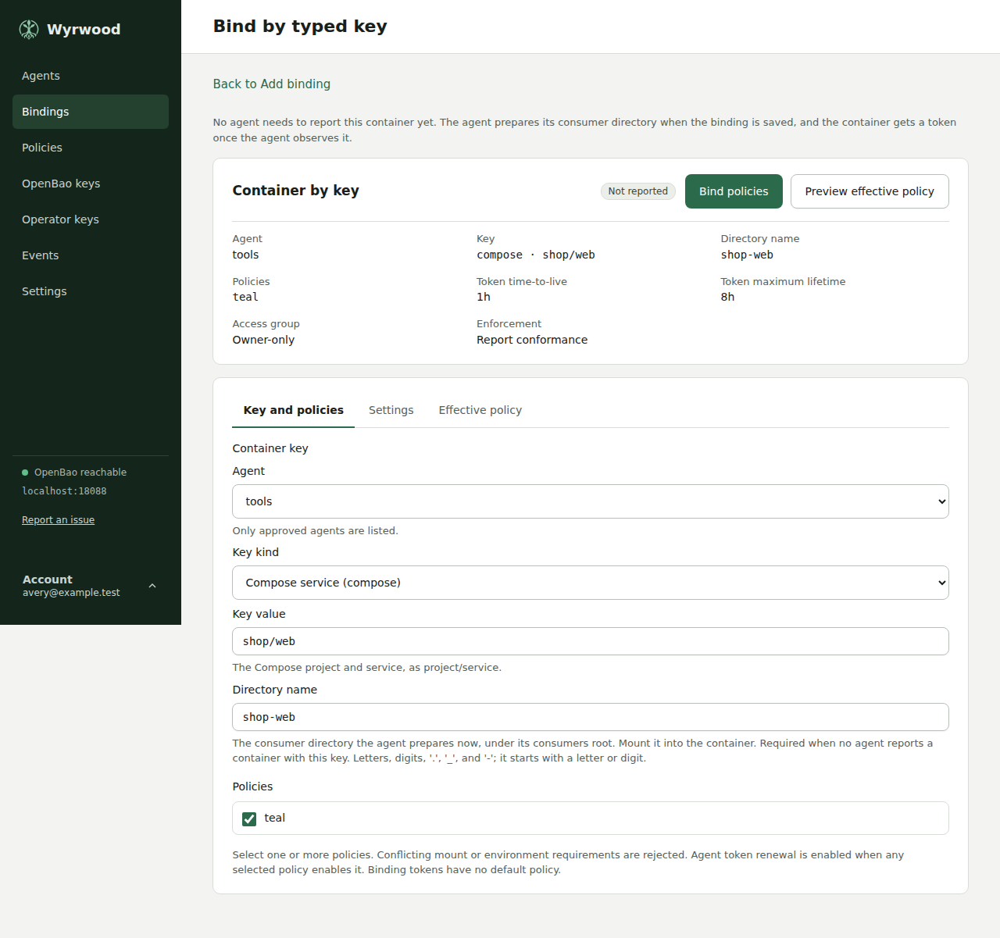

Mount `<consumers root>/<directory name>` into the container at the policy's
mount target, then create and start the container with the key: for a Compose
key, its project and service labels. Every container that the binding governs
uses this directory, also when its name differs. Replicas of a Compose service
share this directory, its sockets, and the binding's token. The agent gets a
token when it observes the container, and revokes it when the container is
removed; the directory and sockets stay. Another binding on the same agent
cannot use the directory name, and the binding keeps it until you unbind. The
**Status** tab and the binding's facts show the directory name.

`wyrwood bind` takes no directory name. Its bind of a key other than `name`, for
a container no agent reports, is stored and waits: the agent prepares nothing
until it reports a container with the key, and then names the directory after
that container.

The policy and binding screens keep their actions at the top and split their
content into tabs. A tab that holds something you should read says **Needs
attention**. A problem from a refused save appears above the tabs, and the
screen selects the tab that holds it.

In **Bindings**, open a binding and select the **Container setup** tab. Copy
the host source, container target, Docker Compose fragment, or `docker run`
example. The examples use the saved effective contract, including its
environment values and custom mount target. Run them on the selected agent
host when creating the container, and keep your application's other options.

The host source comes from the agent's configured consumers root and the
actual container name. The agent manages this directory. Let the agent create
it before starting the container; the Compose fragment disables automatic
host-path creation. The examples do not include application commands, ports,
networks, or unrelated mounts. They do not change an existing container.

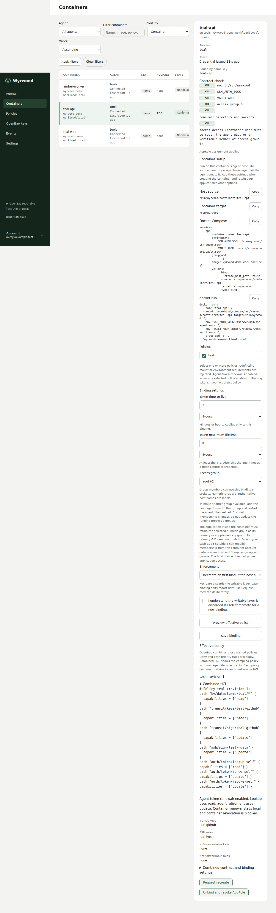

If the report lacks the consumer directory or image, setup examples are
unavailable. An agent that omits the directory must be updated. Follow the
[stopped controller-first rollout](install.md#upgrade-order) before updating
peers. If clipboard access is unavailable, select and copy the displayed
text.

## Binding readiness

The **Status** tab of a binding's screen shows whether its containers can use
their sockets now:

| Readiness | Meaning |
| --- | --- |
| **Ready** | Each container has both sockets and a valid token, and conforms. This holds for a container that has not started. |
| **Waiting** | A step is still to come. The reasons name it, for example no container matches yet, or the token has not arrived. |
| **Failed** | The setup needs a change. The reasons name the consumer directory, the access group, or the contract. |
| **Unknown** | The agent is not connected, so nothing current can be said. |

The tab also shows each consumer directory with the access group applied to it
and the sockets that listen, and the last login or renewal error. A `name`
binding, or a binding with a directory name, with no container shows
**Waiting** with its prepared directory and sockets, so a wrong access group
shows here before the container exists. A recreate that removed the container
and could not create it again shows **Failed** until a container with the key
returns.

## After a host reboot

`/run` is empty at boot and Docker starts before the agent. Docker's start of a
bound container fails on its missing consumer directory, and Docker does not
retry. The agent restores the directory and both sockets from its cached
policy, then starts the container. This does not need `allow-recreate` or the
controller.

The agent starts a container only when all of these hold:

- A binding governs it.
- Its restart policy is `always`, `unless-stopped`, or `on-failure`.
- It is exited, and Docker's recorded error names its consumer directory as
  missing.

A container you stopped on purpose stays stopped. Each start records a
`container-started` event. A failed start is tried again at most once every
five minutes. To read the error Docker recorded:

```bash
docker inspect -f '{{.State.Error}}' app
```

Mount the directory with `--mount type=bind`. With `-v`, Docker creates a
missing source as root at boot and starts the container without sockets. The
agent then rejects that directory and reports `consumer-directory`.

## Operational events

The agent and the controller each retain a bounded event history. Agent
events cover container observation, bindings, contract checks and recreates,
container starts after a reboot,
token login and renewal, vault requests by mount category, and SSH identity
listing, signing, and certificate issuance. Controller events cover operator
sign-in and sign-out, agent approval, operator key approval and revocation,
sessions, policy saves, deletes, and renames, bindings, and credential issuance,
and name the operator who acted. A change made by an operator key names it as
`key:<label>`. Events
contain no tokens, secret values, request bodies, paths, signatures, or raw
upstream errors.

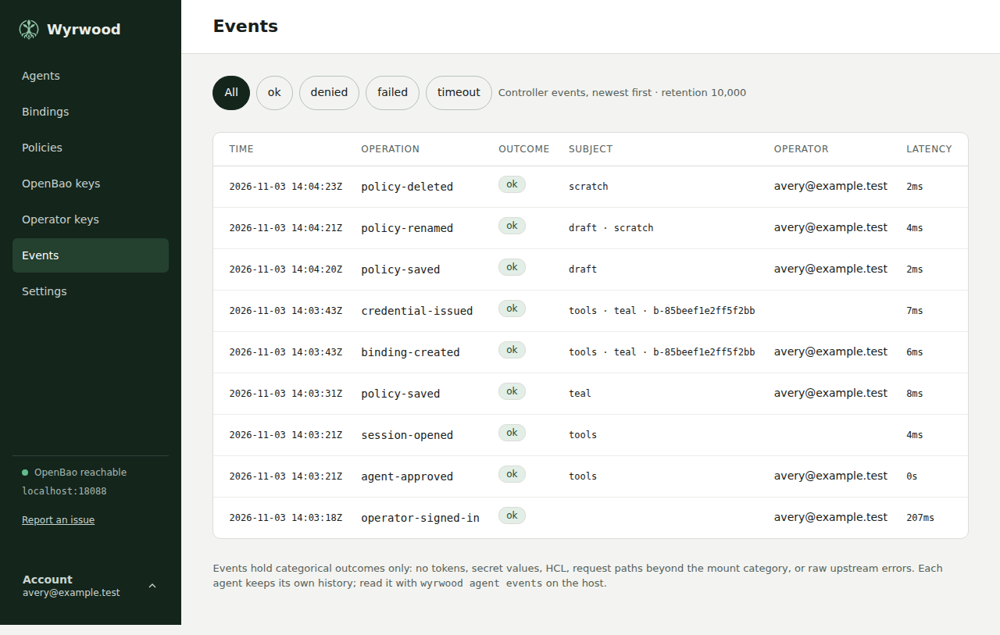

## Manage policies and bindings from a script

An operator key lets a script or a program do what the web interface does for
policies and bindings, inside a grant that you set when you approve the key. The
private key stays on the machine that holds it, and it can stay behind an SSH
agent. An operator key is not an agent key: it has its own list, and neither
kind can act as the other.

On the machine that runs the script, present a key:

```bash
wyrwood operator login ssh://controller.example:2222 --label sample-script
```

This generates a key in your user configuration directory, shows the
controller's host key for you to accept, and records the key as pending. To use
a key in an SSH agent, select it with `--agent-key` by its SHA256 fingerprint,
its public key, or its comment. Only that key is offered, so no other key in the
agent is recorded. An OpenBao Transit key behind a container's `ssh-agent.sock`
can be the identity.

Open **Operator keys** in the web interface, compare the fingerprint, and set
the grant:

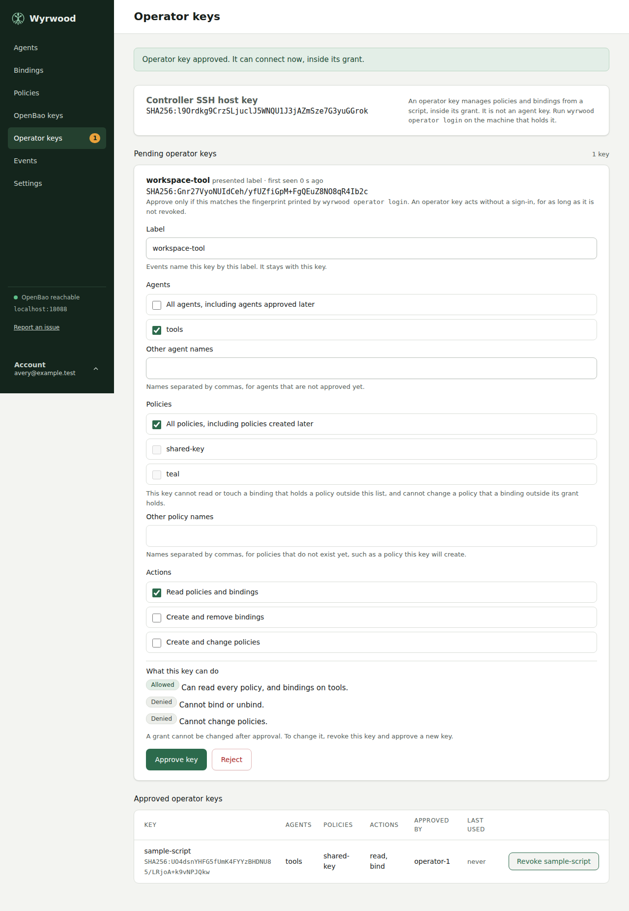

| Grant | What it means |
| --- | --- |
| **Agents** | The agents this key can read and bind on. Select approved agents, or **All agents** for `*`. Type the names of agents that are not approved yet. |
| **Policies** | The policies this key can read, bind, and write. Select stored policies, or **All policies** for `*`. Type the names of policies the key will create. |
| **Read** | List and read policies and bindings inside the grant. |
| **Bind** | Create and remove bindings inside the grant. |
| **Policy write** | Create and change policies inside the grant. |

A binding that holds any policy outside the list is outside the grant, and the
key cannot read, repeat, or remove it. A key with **Policy write** cannot change
a policy that a binding outside its grant holds, since the change reaches that
binding. Together, **Bind** and **Policy write** can reach whatever the
controller's OpenBao namespace can grant, so give both only to a key you would
trust with that.

Below the choices, **What this key can do** states for each action whether the
key can do it, and on which agents and policies. It changes as you choose. Read
it before you select **Approve key**, and compare it with what the script needs:
a grant cannot be changed after approval.

```bash
wyrwood policy put sample-policy --file policy.hcl
wyrwood bind --agent sample-host \
  --key 'devcontainer:/workspaces/sample|.devcontainer/devcontainer.json' \
  --policy sample-policy --access-group 1000
wyrwood binding list --output json
wyrwood unbind --agent sample-host \
  --key 'devcontainer:/workspaces/sample|.devcontainer/devcontainer.json'
```

Each command is safe to run again. A `bind` with the selection the key already
has returns that binding. A `bind` with another selection fails with exit status
10 and changes nothing, so unbind first to change it. An `unbind` of a binding
that is not there succeeds. A binding reports the same readiness as its
**Status** tab, so a script can wait for `ready` before it starts the container.

A key has no expiry. To end one, use **Revoke** on the **Operator keys** screen.
Its next request fails, also on a connection that is open. A revoked key cannot
be approved again, and its label stays with it in the event history, so present
a new key with a new label to replace it. A grant cannot be edited: replace the
key to change it.

Exit status 5 means the key is pending, rejected, or revoked. Status 8 means the
request is outside the key's grant. Status 9 means the policy or binding does
not exist. No command prints a token or secret identifier.

A Go program uses the package `github.com/wyrd-company/wyrwood/operator`
directly. The commands are a thin layer over it. Add it to a module with
`go get github.com/wyrd-company/wyrwood/operator@latest`.

```go
signer, err := operator.SelectAgentKey(agent, "SHA256:sample-fingerprint")
if err != nil {
    return err
}
client, err := operator.Dial(ctx, operator.Config{
    URL:     "ssh://controller.example:2222",
    Signer:  signer,
    HostKey: "SHA256:sample-host-key",
    Label:   "sample-tool",
})
if errors.Is(err, operator.ErrNotApproved) {
    // The key is recorded as pending. An operator approves it in the web interface.
}
```

## Commands

Wyrwood provides human-readable output for interactive use and closed,
versioned JSON for automation.

```bash
sudo wyrwood agent status
sudo wyrwood agent containers
sudo wyrwood agent events --limit 50
sudo wyrwood agent status --output json
```

Successful output goes to standard output. Categorical errors go to standard
error. Automation can distinguish usage, login, daemon, controller, grant, and
fingerprint failures by exit status without parsing error text.

| Command | Purpose |
| --- | --- |
| `wyrwood controller serve` | Run the controller and its optional local agent. |
| `wyrwood controller host-key` | Print the controller's SSH host-key fingerprint. |
| `wyrwood agent login <url>` | Generate the agent key, accept the controller fingerprint, and request approval. |
| `wyrwood agent daemon` | Run the agent through its Engine proxy. |
| `wyrwood agent engine-proxy [--config PATH]` | Run the filtering Engine boundary. |
| `wyrwood agent status` | Inspect agent, controller session, and binding health. |
| `wyrwood agent containers` | List observed containers with binding, conformance, and token state. |
| `wyrwood agent events` | Read the newest bounded operational events. |
| `wyrwood agent service install\|remove\|start\|stop\|status` | Manage the system service pair. |
| `wyrwood operator login <url>` | Present an operator key and request approval. |
| `wyrwood operator whoami` | Print the key's label and grant. |
| `wyrwood policy put\|get\|list` | Manage policies inside the key's grant. |
| `wyrwood bind`, `wyrwood unbind` | Create and remove a binding. Both are safe to repeat. |
| `wyrwood binding list\|get` | Read bindings with their readiness. |
| `wyrwood version` | Print the executable version. |

Run `wyrwood help` for the top-level grammar or append `--help` to a command
for its options.

## Agent and Engine proxy

`wyrwood-agent.service` runs as `wyrwood`. Its dependency
`wyrwood-engine-proxy.service` runs as `wyrwood-engine` with Docker access.
Restart the agent to activate both its configuration and the proxy's
root-controlled `allow-recreate` setting:

```bash
sudo systemctl restart wyrwood-agent.service
sudo systemctl status wyrwood-agent.service wyrwood-engine-proxy.service
```

The proxy permits four reads: container list, container inspect, filtered
container events, and image inspect. It also permits container start, with no
query or body. Stop, remove without volumes or force, and create are allowed
only with host recreate enabled. All other Engine routes are denied. A
compromised agent can start any stopped container, on any host. A
recreate-enabled host still grants possible
host-root authority to a compromised agent.

A proxy failure leaves Engine operations unavailable while existing consumer
sockets continue serving. Reconnect uses the filtered socket and full
reconciliation; it does not switch to the raw Engine socket. A restart during
recreation follows the [existing recovery
procedure](configuration.md#contract-enforcement).

## OpenBao namespace secret access

Members of `wyrwood_admins` can sign in to OpenBao directly to manage ad-hoc
secrets. This is a separate OIDC client and application session from the
controller's sign-in. The controller's allowed groups and AppRole policy stay
unchanged. An OpenBao administrator performs setup; the controller service
never configures auth methods.

Set the public cluster UI base and namespace in the controller configuration:

```yaml
openbao:
  address: https://api.example:8200
  namespace: wyrwood
  ui-url: https://vault.example/ui/openbao
  # Keep the existing approle, CA and managed-mount settings.
```

`ui-url` includes the deployed `/ui/<cluster>` route and any proxy prefix. It
can use a different hostname from the API address. HTTPS is required except
for loopback tests. With this example, register exactly
`https://vault.example/ui/openbao/auth/admin-oidc/oidc/callback` on the separate
OpenBao OIDC client. The namespace travels in OIDC state, not the callback
query. Request the `profile`, `email`, and `groups` scopes and release a groups
claim that includes the exact string `wyrwood_admins` for admitted accounts.

Have an OpenBao site administrator supply a provisioning token issued in the
target namespace. Its [exact provisioning
ACL](https://github.com/wyrd-company/wyrwood/blob/main/docs/technical-designs/openbao-admin-access.yml)
can write the `namespace-admin` policy and configure `auth/admin-oidc`. Treat
that policy writer as namespace administration authority. Keep its input file
under the administrator's control; do not give it to the controller or secret
admins. Revoke it through the site's process after use. Root on the local
machine is not required.

Pipe the OIDC client secret from your secret source into the command. For
example, with an administrator-managed input file:

```bash
wyrwood controller openbao-admin configure \
  --config /etc/wyrwood/controller.yml \
  --token-file /run/secrets/provisioning-token \
  --client-id openbao-admin-client --client-secret-stdin \
  --kv-v2-mount kv --token-ttl 1h --token-max-ttl 8h \
  < /run/secrets/openbao-client-secret
```

Choose the TTL and maximum explicitly. These example values are not defaults.
The issuer and claim key default to the controller's public OIDC settings;
`--issuer URL` and `--groups-claim KEY` override them. The client secret is
consumed from piped stdin without an interactive prompt. Wyrwood never saves
or logs it, and never reads the controller's runtime secret files for this
command. OpenBao stores its required copy in protected backend storage. Keep
OpenBao audit HMAC protection for the field and verbose OIDC logging disabled.

Repeat `--kv-v2-mount` to grant another existing KV v2 mount. The role grants
read, create, update, list, delete, restore, and permanent version/metadata
deletion on all values in those mounts, including existing workload secrets.
It also grants own-token lookup, renewal, revocation, and UI capability
inspection. It grants no policy, AppRole, auth-method, engine-mount, Transit,
SSH, identity, or child-token administration. Keep its OpenBao identity aliases
free of extra entity or group policies. A person who also operates Wyrwood
retains that separate controller authority.

The sidebar and policy editor show **OpenBao UI**, opening the selected
namespace's secret-engine list in a new tab. OpenBao handles sign-in; an
existing OpenBao session retains its own authority. The editor's unsaved form
stays in place. An absent or empty `ui-url` hides both links. Opening a link
or signing out of Wyrwood does not grant or revoke OpenBao access.

Setup recognizes its dedicated resources and refuses conflicting policies,
auth mounts or extra roles. An error reports its stage and whether partial
configuration can remain. Rerun setup with the complete explicit inputs to
finish or rotate the client secret, or remove the owned resources:

```bash
wyrwood controller openbao-admin remove \
  --config /etc/wyrwood/controller.yml \
  --token-file /run/secrets/provisioning-token
```

Removal disables the dedicated auth mount first, revoking its issued tokens
and leases, then deletes its ACL policy. It preserves KV values and mounts,
the namespace, controller policy/AppRole and binding policies/AppRoles.
Remove or rotate the separate provider client, revoke the provisioning token,
and remove `ui-url` from configuration to hide the links. Group removal only
stops subsequent logins; issued tokens need revocation or expiry at their
explicit maximum lifetime. Deleting only the role does not revoke sessions.
