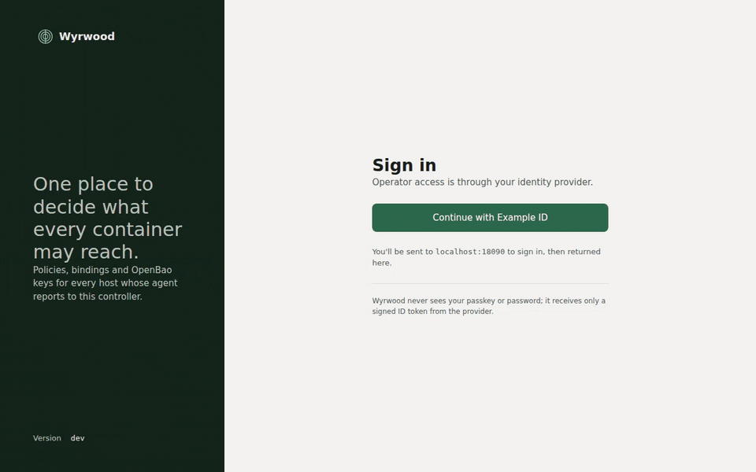

Wyrwood delivers OpenBao-backed secrets and signing to containers through a
per-container directory of Unix sockets. A container holds no token, no key,
and no secret file.

Wyrwood has two parts:

- The **controller** runs once per site as a container. It owns policy, serves
  a web interface, and holds the only OpenBao credential that can write
  policies and AppRoles.
- The **agent** runs on each Linux host with Docker Engine. It enrolls with the
  controller over SSH, reports every container, and publishes each bound
  container's sockets.

A **policy** pairs an OpenBao policy with a container contract. The OpenBao
policy names the secrets a container may read and the keys it may sign with.
The contract names the mount, environment values, and access group the
container must have, and whether the agent only reports a container that
lacks them or recreates it once at binding time.

A **binding** attaches a policy to a container by the most stable identity the
engine offers: devcontainer labels first, then compose labels, then the
container name. The controller creates one OpenBao AppRole per binding and
hands the agent a role and a wrapped secret. The agent logs in, keeps the
token in memory, and renews it when a selected policy enables agent token renewal.

Inside the container, the mounted directory holds two sockets:

- `vault.sock` speaks the OpenBao API. The agent replaces whatever credential
  the client sends with the container's own token. A tool that insists on
  logging in first receives a placeholder and proceeds.
- `ssh-agent.sock` is a standard SSH agent. Its identities are OpenBao Transit
  keys and OpenBao SSH-engine certificates named by the policy. Every
  signature is produced by OpenBao.

Mounting the directory rather than a socket file keeps a replaced socket
visible inside a running container. Removing a key or path from the policy
takes effect on the next request without a restart.

Wyrwood retains only bounded, categorical operational events. They contain no
tokens, secret values, signatures, payloads, paths, or raw upstream errors.

The agent supports Linux hosts with Docker Engine. The controller runs
anywhere a container can reach OpenBao and accept SSH connections from agents.
